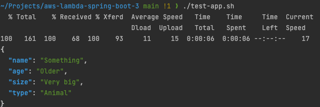
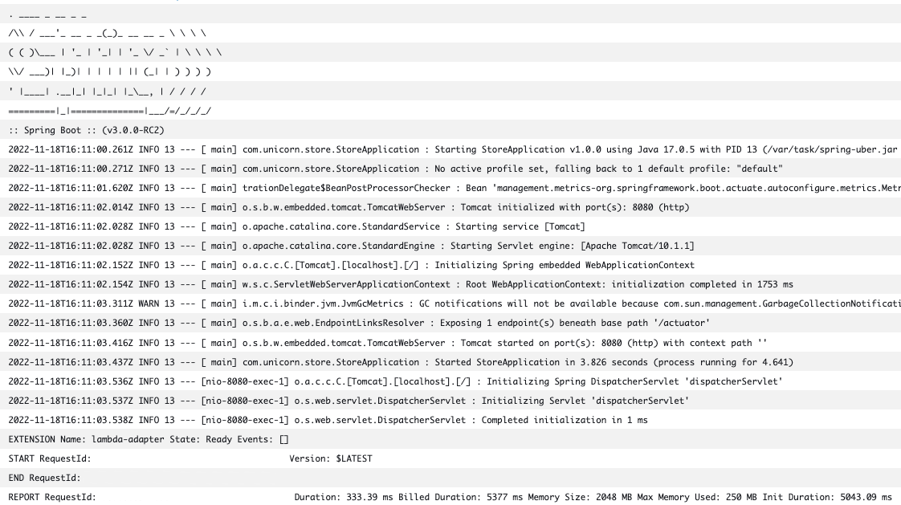

# Unicorn Store - Spring Boot 3 on AWS Lambda


A production-ready example of a **Spring Boot 3** application running as an **AWS Lambda** function with **Java 17**. The Unicorn Store is a serverless REST API that accepts unicorn data and publishes events to **Amazon EventBridge**.

This project leverages the [AWS Serverless Java Container](https://github.com/awslabs/aws-serverless-java-container) library (v2.0.0-M2) for seamless compatibility between API Gateway events and Spring Boot 3. For a deeper walkthrough, see the [Java on AWS Lambda Workshop](https://catalog.workshops.aws/java-on-aws-lambda/en-US/01-migration/01-setup-and-deploy/java-container).

---

## Architecture

```
                         +-----------------+       +-------------------+       +------------------+
  Client Request ----->  | API Gateway     | ----> | AWS Lambda        | ----> | Amazon           |
  POST /unicorns         | (REST, Proxy)   |       | (Spring Boot 3)   |       | EventBridge      |
                         +-----------------+       +-------------------+       +------------------+
                                                          |                         |
                                                   SnapStart enabled         Event Bus:
                                                   2048 MB memory            "unicorns-spring"
                                                   29s timeout
```

**Request Flow:**

1. A client sends a `POST /unicorns` request to the API Gateway endpoint.
2. API Gateway proxies the request to the Lambda function.
3. The `StreamLambdaHandler` translates the API Gateway event into a Spring Boot request using the Serverless Java Container library.
4. The `UnicornController` receives the request and delegates to `UnicornService`.
5. `UnicornService` calls `UnicornPublisher`, which publishes a `UNICORN_CREATED` event to the `unicorns-spring` EventBridge bus.
6. The created unicorn object is returned in the response.

**Key optimizations:**
- **SnapStart** - Pre-initializes the Lambda execution environment for dramatically reduced cold start times
- **Async initialization** - The Spring Boot context is initialized asynchronously during the Lambda init phase
- **AWS CRT HTTP Client** - High-performance HTTP client for EventBridge communication
- **No embedded Tomcat** - Excluded at build time since API Gateway handles HTTP concerns

---

## Project Structure

```
aws-lambda-spring-boot-3/
|
|-- unicorn-store-spring/                  # Spring Boot application
|   |-- pom.xml                            # Maven build config (Shade plugin)
|   +-- src/main/java/com/unicorn/store/
|       |-- StoreApplication.java          # Spring Boot main class
|       |-- StreamLambdaHandler.java       # Lambda entry point
|       |-- controller/
|       |   +-- UnicornController.java     # REST controller (POST /unicorns)
|       |-- service/
|       |   +-- UnicornService.java        # Business logic layer
|       |-- data/
|       |   +-- UnicornPublisher.java      # EventBridge event publisher
|       |-- model/
|       |   |-- Unicorn.java               # Unicorn data model
|       |   +-- UnicornEventType.java      # Event type enum
|       +-- exceptions/
|           |-- PublisherException.java     # Publishing error
|           +-- ResourceNotFoundException.java
|
|-- infrastructure/
|   |-- cdk/                               # AWS CDK infrastructure (Java)
|   |   |-- pom.xml
|   |   +-- src/main/java/com/unicorn/
|   |       |-- UnicornStoreApp.java       # CDK app entry point
|   |       +-- UnicornStoreSpringStack.java # Stack definition
|   +-- loadtest.yaml                      # Artillery load test config
|
|-- deploy.sh                              # Deployment script
|-- test-app.sh                            # API test script
+-- img/                                   # Screenshots
    |-- result.png
    +-- logs.png
```

---

## Tech Stack

| Layer              | Technology                                                  |
| :----------------- | :---------------------------------------------------------- |
| **Language**       | Java 17                                                     |
| **Framework**      | Spring Boot 3.1.4                                           |
| **Compute**        | AWS Lambda (with SnapStart)                                 |
| **API**            | Amazon API Gateway (REST API, proxy integration)            |
| **Events**         | Amazon EventBridge (`unicorns-spring` event bus)            |
| **AWS SDK**        | AWS SDK for Java v2 (EventBridge async client + CRT HTTP)   |
| **Infrastructure** | AWS CDK v2 (Java)                                           |
| **Packaging**      | Maven Shade Plugin                                          |
| **Load Testing**   | Artillery                                                   |

---

## Prerequisites

Before you begin, ensure you have the following installed:

- **Java 17** (or later)
- **Apache Maven** (3.8+)
- **AWS CDK CLI** -- [Installation Guide](https://docs.aws.amazon.com/cdk/v2/guide/cli.html)
- **AWS CLI** with credentials configured (`aws configure`)
- **jq** (for the test script)

---

## Getting Started

### 1. Build the Application

Compile the Spring Boot application and produce the shaded JAR:

```bash
mvn clean package -f unicorn-store-spring/pom.xml
```

Copy the packaged artifact to the CDK app directory:

```bash
cp unicorn-store-spring/target/spring-boot-lambda.jar infrastructure/cdk/app/
```

> **Note:** The Shade plugin produces `spring-boot-lambda.jar` with embedded Tomcat excluded, keeping the deployment package optimized for Lambda.

### 2. Bootstrap AWS CDK (First Time Only)

If this is your first time using CDK in your AWS account/region:

```bash
cdk bootstrap
```

### 3. Deploy to AWS

Run the deployment script, which uses CDK to provision all resources:

```bash
./deploy.sh
```

This command runs `cdk deploy --all` and creates:
- A Lambda function (`unicorn-store-spring-boot-3`) with SnapStart enabled
- An API Gateway REST API (`UnicornStoreSpringApi`) with proxy integration
- An EventBridge event bus (`unicorns-spring`)

Deployment outputs (including the API endpoint URL) are saved to `infrastructure/cdk/target/output.json`.

### 4. Test the Deployment

Send a sample request to the deployed API:

```bash
./test-app.sh
```

This sends a `POST /unicorns` request with sample unicorn data to the API Gateway endpoint.

---

## API Reference

### Create Unicorn

Creates a new unicorn and publishes a `UNICORN_CREATED` event to EventBridge.

**Endpoint:**

```
POST /unicorns
```

**Request Body:**

```json
{
  "name": "Something",
  "age": "Older",
  "type": "Animal",
  "size": "Very big"
}
```

| Field    | Type   | Description              |
| :------- | :----- | :----------------------- |
| `name`   | String | Name of the unicorn      |
| `age`    | String | Age descriptor           |
| `type`   | String | Type/breed of unicorn    |
| `size`   | String | Size descriptor          |

**Response:**

```json
HTTP/1.1 200 OK
Content-Type: application/json

{
  "name": "Something",
  "age": "Older",
  "type": "Animal",
  "size": "Very big"
}
```

**Error Response:**

```json
HTTP/1.1 500 Internal Server Error

{
  "status": 500,
  "error": "Internal Server Error",
  "message": "Error creating unicorn"
}
```

---

## Load Testing

An [Artillery](https://www.artillery.io/) configuration is included for load testing:

```bash
artillery run -t <API_ENDPOINT_URL> infrastructure/loadtest.yaml
```

The test sends **25 requests per second** for **60 seconds** (1,500 total requests) with a 29-second timeout per request.

---

## Results

### API Response



### CloudWatch Logs



---

## Lambda Configuration

| Setting            | Value                                              |
| :----------------- | :------------------------------------------------- |
| **Runtime**        | Java 17 (`JAVA_17`)                                |
| **Handler**        | `com.unicorn.store.StreamLambdaHandler::handleRequest` |
| **Memory**         | 2048 MB                                            |
| **Timeout**        | 29 seconds                                         |
| **SnapStart**      | Enabled (on published versions)                    |
| **Lambda Layer**   | Lambda Web Adapter (x86)                           |
| **Function Name**  | `unicorn-store-spring-boot-3`                      |

---

## Cleanup

To remove all deployed resources and avoid ongoing charges:

```bash
cd infrastructure/cdk
cdk destroy --all
```

---

## Resources

- [AWS Serverless Java Container](https://github.com/awslabs/aws-serverless-java-container) -- Bridge library for running Spring Boot on Lambda
- [Java on AWS Lambda Workshop](https://catalog.workshops.aws/java-on-aws-lambda/en-US/01-migration/01-setup-and-deploy/java-container) -- Hands-on workshop for this pattern
- [AWS Lambda SnapStart](https://docs.aws.amazon.com/lambda/latest/dg/snapstart.html) -- Documentation on Lambda SnapStart for Java
- [AWS CDK Developer Guide](https://docs.aws.amazon.com/cdk/v2/guide/home.html) -- AWS CDK v2 documentation
- [Spring Boot on AWS Lambda](https://aws.amazon.com/blogs/compute/re-platforming-java-applications-using-the-updated-aws-serverless-java-container/) -- AWS blog on re-platforming Java apps
